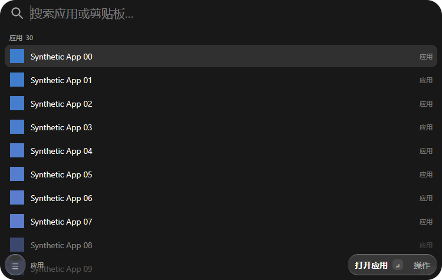
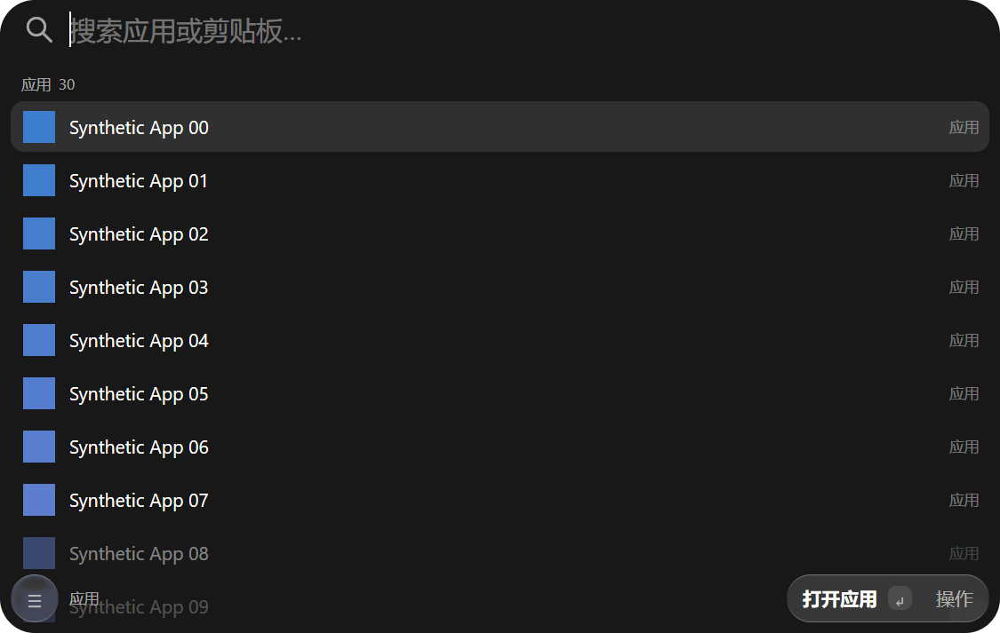

# MyCast

受 [Tinycast](https://github.com/abue-ammar/tinycast) 启发的 Windows 常驻启动器首版。采用 [MyGo](https://github.com/egoist/mygo) 的原生 Go UI，不使用 Electron、HTML 或 WebView 页面。

> 当前为可审查的早期版本。Windows 原生交互、中文输入法、托盘及回填仍需在实际 Windows 10/11 桌面验证；编译通过不等于实机验收。

## 界面预览

以下图片由 MyGo 离屏渲染器生成，分别对应 100% 和 150% DPI。应用名称、路径与图标均为合成测试数据，不含用户真实应用清单；它们不是实机截图，也不代表真实桌面的热键、IME、托盘、焦点或回填已验收。

本轮标准面板为 750×475 DIP，页头 44、页脚 52；圆角、图标、间距、字号与色阶统一在 `internal/launcher/palette_tokens_windows.go`。搜索与结果名称列对齐，页头/页脚浮在完整滚动列表上，不使用硬分隔条。左侧圆菜单和右侧操作胶囊使用 MyGo 内置 glass，仅采样同窗口内的绘制内容；主面板请求 Windows Acrylic，并通过 `c.Vibrancy()` 决定透明 scrim 或纯色降级。

渐隐采用 MyGo 已支持的逐行透明度近似，不是 Tinycast 的逐像素渐变遮罩；键盘选择会避开浮动栏，滚轮滚动不会被自动拉回。同窗口菜单关闭后恢复搜索焦点，并消费点击外部的整次点击。真实 Windows 的 Acrylic 显示、原生窗口圆角裁剪和透明边角仍未实机验证，不能由离屏图推断。compact/expanded 窗口状态留待后续迭代。





[空态（150%）](docs/previews/clipboard-empty-150.png) · [合成剪贴板（150%）](docs/previews/clipboard-150.png) · [菜单（150%）](docs/previews/menu-150.png) · [末项选中（150%）](docs/previews/last-selected-150.png)

## 首版功能

- Ctrl+Alt+Space 全局热键呼出/隐藏，托盘常驻、右键菜单、单实例
- 原生搜索框；Unicode 大小写不敏感搜索，支持中文字符匹配
- 扫描用户/公共开始菜单及桌面的 `.lnk`、`.exe`，搜索后启动
- 只读加载快捷方式的目标、原样参数、工作目录及启动标志；仅合并已确认普通启动语义的重复项。不同参数、目录、特殊权限/兼容标志、非默认窗口模式或无法读取的快捷方式保持独立，启动仍使用原快捷方式
- 搜索栏置顶、深色紧凑图标列表、整行选中；同名应用显示目标/参数/工作目录副标题；文本记录、暂停、清空及重新扫描集中在底部设置菜单
- ↑/↓ 选择，Enter 打开，Esc、失焦或关闭按钮隐藏
- 文本剪贴板历史：手动开启、去重、最多 50 条、单条最多 64 KiB UTF-8；Win32 读取另限制 64 KiB UTF-16 数据
- 从热键呼出后选择历史，可尝试回填原窗口；从托盘打开只复制，使用 Ctrl+V 手动粘贴
- 历史随退出清空，可暂停、清空；应用索引可手动重新扫描

中文搜索目前按实际字符匹配，不提供拼音转写或拼音首字母搜索。输入框使用 MyGo 的 Windows IME 支持，组合输入期间不会执行启动/隐藏快捷动作；微软拼音等输入法尚未实机验收。

不含 Raycast 扩展兼容、文件全文索引、图片剪贴板、UWP 专用枚举、自动更新、开机自启或设置持久化。已在开始菜单提供快捷方式的应用可以被索引。当前使用环境变量对应的常规桌面目录，OneDrive/组策略重定向桌面可能漏索引。热键冲突时通过托盘打开。

## 构建

需要官方 **Go 1.27.2**。锁定 MyGo **v0.4.6**，对应最初检查的 commit `bc111b6d2cca221716ad99ddea1580449ad8c18e`。其 `go.mod` 要求 Go 1.27.1 或更高；不要随意降低版本号绕过工具链检查。

Windows PowerShell：

```powershell
go mod download
go test ./...
go vet ./...
$env:CGO_ENABLED = '0'
go build -trimpath -tags mygo_noinspector -ldflags '-H windowsgui -s -w' -o dist/MyCast.exe ./cmd/mycast
.\dist\MyCast.exe
```

可设置 `MYCAST_PREVIEW_DIR` 为测试输出目录，再运行 `go test ./internal/launcher`，生成合成应用的 100%/150% DPI 离屏界面图。布局测试覆盖搜索框、首行完整边界、滚动/筛选/模式切换重置；它不替代真实桌面的 IME、焦点、热键或回填验收。

Linux/macOS 交叉编译：

```sh
CGO_ENABLED=0 GOOS=windows GOARCH=amd64 go build -trimpath -tags mygo_noinspector -ldflags '-H windowsgui -s -w' -o dist/MyCast.exe ./cmd/mycast
```

GitHub Actions 的 `Windows build and core tests` 工作流在 Windows runner 执行测试、vet 和构建，产生 `MyCast-windows-amd64` artifact（下载即一个 zip，内含 exe 与许可文件，不嵌套压缩）；不会自动发布 Release。程序未代码签名，系统可能提示未知发布者。只从你信任的源码构建；不要关闭系统安全保护。

## 隐私与安全

- 没有遥测、互联网请求、云同步、账户、数据库或历史磁盘文件。MyGo 单实例检查使用本机 IPC socket，与其它本地实例通信，不上传内容。
- 剪贴板记录默认关闭，用户在本次运行主动开启后才开始；开启时不会导入现有剪贴板内容。暂停后已有历史仍留内存，清空按钮可移除，退出自动清空。系统及Go运行时可能仍暂存内存副本，清空不是密码学擦除。
- 只收集之后复制的纯文本，可能包含密码或其它敏感信息。本版无法可靠识别所有密码管理器/敏感来源；处理秘密前请暂停记录。不会读取用户现有历史数据库。
- 回填仅由用户按 Enter 或点击历史行触发，目标为这次热键呼出之前的窗口；从托盘打开不自动回填。不安装全局键盘 hook，不记录按键。
- 回填只向呼出前捕获的焦点控件发送定向 `WM_PASTE`，不会注入全局按键。有焦点和窗口身份有效性检查；若无法安全完成，则显示错误并提供“仅复制”手动粘贴。管理员窗口、浏览器、游戏、自绘编辑器可能拒绝或忽略 `WM_PASTE`。消息调用返回成功也不能证明目标已插入文本；未插入时请使用“仅复制”后手动 Ctrl+V。发送前还会核对剪贴板变化序号；系统剪贴板是共享资源，检查与目标读取之间无法原子锁定，其他程序同时改写仍有极短竞态。回填会将所选文本留在系统剪贴板，不自动恢复旧内容，以免覆盖用户的新复制。
- 应用启动只接受索引中的绝对 `.lnk` / `.exe` 路径，通过 Windows ShellExecute 启动，不拼接 shell 命令。快捷方式及目标程序仍需来自可信来源。
- 不要用管理员权限运行 MyCast 来绕过目标应用权限。

## 结构

- `internal/core`：搜索排序、文件索引、内存历史及纯逻辑测试
- `internal/platform`：Windows 剪贴板、窗口和进程启动接口，非 Windows stub
- `internal/launcher`：MyGo 原生窗口、生命周期、托盘、热键、输入和状态
- `cmd/mycast`：平台入口

借鉴 Tinycast 将决策逻辑与平台副作用、界面分离的架构；当前核心为重新实现的 Go 代码，未逐行翻译 Swift。项目使用 AGPL-3.0-or-later，MyGo 等依赖保留各自许可证，见 [THIRD_PARTY_NOTICES.md](THIRD_PARTY_NOTICES.md)。

## 手动验收清单

1. 标准用户启动，托盘出现；重复运行只显示已有窗口；退出后无残留进程
2. 热键连续打开/隐藏；失焦、Esc、Alt+F4 隐藏；托盘能重新打开
3. 微软拼音输入“记事本”，候选确认 Enter 不误启动；候选取消 Esc 不误隐藏；英文/中文/emoji编辑正常
4. 搜索 .lnk 和 .exe，Enter/点击启动；删除目标后显示错误；热键被占用时仍能托盘操作
5. 默认不记录；开启时不读取原有文本；之后复制中文文本可见；重复去重、过大文本忽略、暂停和清空生效
6. 从记事本热键呼出，选择文本回填原窗口；原窗口已关闭/权限不符时不回填其它窗口；托盘打开仅复制
7. 重启后历史为空；多显示器/高DPI窗口可读；任务栏重启后检查托盘恢复情况（未保证）
