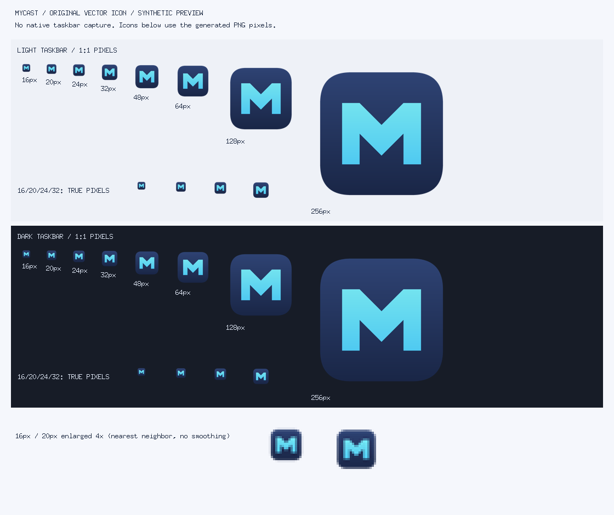

# Original MyCast Windows icon

The icon is original repo-native artwork: a compact geometric M with directional
chevron folds, cyan-to-blue ink and a dark indigo rounded tile. The exterior is
transparent. It contains no font, copied logo, desktop image or glass effect.
The canonical source is [mycast.svg](../assets/brand/mycast.svg), licensed with
the repository under AGPL-3.0-or-later.



The preview includes 16/20/24/32/48/64/128/256px at 1:1, a repeated small-size
strip, and 16/20px enlarged with nearest-neighbor pixels. Its light/dark strips
are synthetic taskbar backgrounds, **not native desktop screenshots**.

## Reproducible assets and Windows integration

From the repository root, with official Go 1.27.2 and locked dependencies:

```powershell
go run ./scripts/generate-icon
go run ./scripts/generate-icon -check
go test ./...
go vet ./...
$env:CGO_ENABLED = '0'
go build -trimpath -tags mygo_noinspector -ldflags '-H windowsgui -s -w' -o dist/MyCast.exe ./cmd/mycast
go run ./scripts/verify-icon -exe dist/MyCast.exe
go run -tags mygo_noinspector ./scripts/verify-window-icon
```

The generator uses the SVG's paths/gradients and eightfold rasterization with
the existing locked x/image resampler. Its deliberately narrow SVG subset rejects
unsupported geometry. No external renderer/resource compiler or new runtime
dependency is required. Outputs include eight PNGs, a PNG-backed multi-size ICO,
the preview and `cmd/mycast/icon_windows_amd64.syso`. The deterministic read-only
COFF object has neutral-language RT_GROUP_ICON/1 and eight RT_ICON payloads.
The Go linker relocates resource RVAs; ordinary local/CI/offline amd64 builds all
pick up the same checked-in object. Generation checks run in tests and CI.

The palette calls MyGo v0.4.6 `Window.SetIcon(branding.WindowPNG())` immediately
after native window creation. MyGo makes the small/large HICONs at the window DPI
and owns their replacement/destruction. MyCast neither retains nor destroys those
handles. The tray receives the same artwork through `TrayOptions.Icon`; its own
MyGo lifecycle releases the tray icon. The EXE resource covers Explorer/shortcuts;
the window interface covers window/title/taskbar icons when Windows displays them.
The existing tray-first `SkipTaskbar` behavior is unchanged.

## Evidence and limits

ICO tests check all sizes, transparent corners, distinguishable ink and malformed
data. COFF tests check read-only section/neutral timestamps/relocations and exact
group/payload content. The build verifier reads PE data without executing it and
requires the group and every PNG to match the canonical ICO byte for byte; the
same verifier gates packaging and CI.

The Windows fixture also maps this verified EXE with DATAFILE_EXCLUSIVE |
IMAGE_RESOURCE, never executable loading, and loads/destroys an owned HICON at
each of the eight sizes. The image mapping is released after those checks.

A separate dedicated hidden MyGo window (no tray, clipboard, app scanning or
keyboard/mouse input) checks both WM_GETICON handles and valid 16/32 bitmap sizes
at this host's DPI. Thirty-two replacements stay within a bounded USER-object
count and restoring the application icon succeeds. This is native ABI/lifecycle
evidence, **not visual taskbar acceptance**. Actual Explorer/taskbar/tray appearance,
shell icon caching, high-DPI transitions and multi-monitor composition remain
unverified locally because native desktop screenshot/input control is unavailable.
